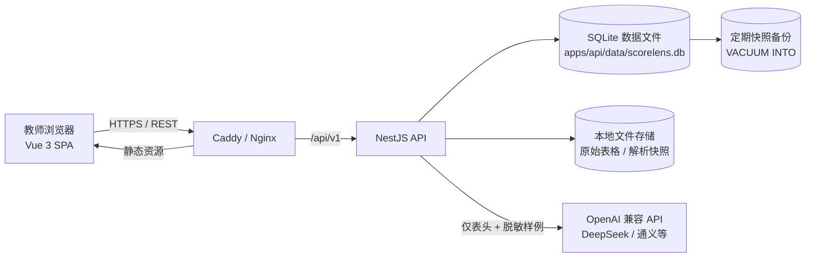
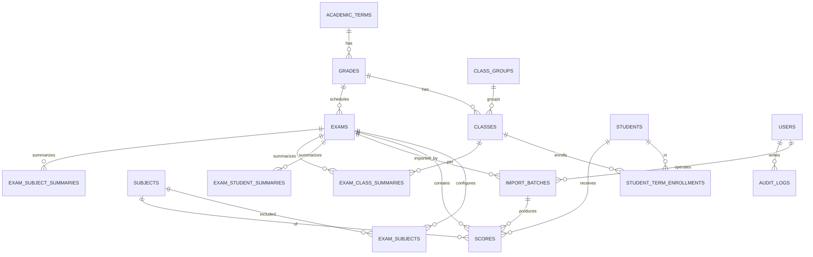
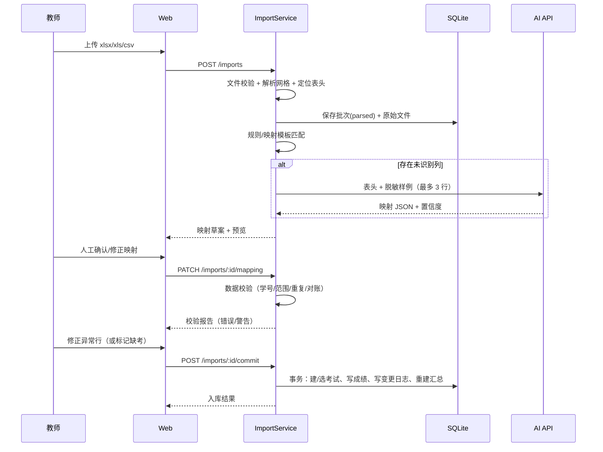

# 成绩云析（ScoreLens）项目架构设计

> 文档版本：v0.1（讨论稿）
> 更新日期：2026-11-23
> 适用版本：首版（初中文化科目）
> 关联文档：[技术选型](./02-技术选型.md)｜[功能清单](./03-功能清单.md)
> 说明：本文描述目标架构，包含后续规划能力；v0.3.0 实际实现范围以[开发记录](./05-开发记录.md)为准。

---

## 1. 背景与目标

### 1.1 要解决的问题

学校在月考、期中、期末后，各科老师提交的 Excel 格式不统一：表头命名不同、存在合并单元格、夹带总分/排名列、缺考标记五花八门。班主任和年级主任需要手工汇总、排名、对比，耗时且容易出错。

系统要完成一条固定链路：

**上传表格 → 解析 → 表头映射 → 人工确认 → 校验 → 入库 → 自动汇总 → 可视化分析**

### 1.2 产品目标

- 教师上传 Excel/CSV，系统自动识别表格结构并映射到统一模型，无需每次手工配列。
- 入库后自动生成班级、年级、学生三个维度的分析结果。
- 支持历史考试回溯，形成班级/学生/学科的趋势。
- AI 只负责"识别表格结构与表头"，不参与数值计算和写库；所有分数由程序确定性处理。
- 单校本地/内网可部署，数据可审计、导入可撤销。

### 1.3 已确认前提

- 学段为初中，同年级/同班学生全科统一，不做选科/走班。
- 首版只处理文化科目成绩；体育、实验操作、会考/等级科目暂不纳入，后续通过科目配置扩展。
- 各科满分按考试科目配置，不硬编码；不同地区可使用不同满分（如语文 120、数学 150、英语 120）。
- 及格/优秀比例默认 **60% / 80%**；缺考学生剔除总分排名；导入撤销窗口 24 小时。
- 需要导入历史学期成绩，用于班级/学生趋势。
- 系统定位为"成绩导入 + 可视化分析"，首版不承担教务考试编排；考试记录由班主任/年级主任在导入时创建或确认。
- 导入默认由班主任、年级主任发起（管理员可代操作）；任课老师默认只读本科数据，后续可按需开放单科导入权限。
- AI 表头映射使用国内 OpenAI 兼容 API（DeepSeek/通义等），可配置切换。
- 开发环境为 Windows 本机；测试部署环境为 Ubuntu 24.04；正式部署环境待定，架构保持本地优先、可平移。

### 1.4 用户与范围

| 角色 | 主要诉求 | 数据范围 |
| --- | --- | --- |
| 年级主任 | 全年级班级对比、学科强弱、各班导入进度 | 所负责年级的全部班级 |
| 班主任 | 本班总分/各科/排名/临界生/学生档案 | 所带班级全部科目 |
| 任课老师 | 查看所教科目的成绩与分析（首版默认只读） | 所教班级 ∩ 所教科目 |
| 系统管理员 | 基础数据、账号权限、考试、设置、审计 | 全部 |

首版范围：

- 学段：初中。
- 科目：文化科目（语文、数学、英语、物理、化学、生物、道德与法治、历史、地理）。
- 考试：月考、期中、期末等正规考试。
- 暂不纳入体育、实验操作、会考/等级科目；后续通过科目配置和"是否计入总分"扩展。
- 地理/生物按学校实际组织方式处理：若是会考或等级制，默认不纳入总分，可在考试科目配置中排除；首版不实现等级转换。
- 系统定位：成绩导入 + 可视化分析；不承担教务考试编排、排课、阅卷。
- 仅教师端，不含学生端/家长端。
- 单校单实例；桌面浏览器优先。

### 1.5 设计原则

1. **确定性优先**：AI 只产出映射建议，入库数据由程序按固定规则转换。
2. **人工确认**：映射、低置信度列、异常数据必须人工确认后才能入库。
3. **可审计**：原始文件、映射快照、校验报告、变更前后值、操作人全部留痕。
4. **性能内建**：汇总预计算 + 页面聚合接口 + 前端缓存，避免切页等待。
5. **单体优先**：模块化单体，不引入微服务、Redis、消息队列等额外基础设施。
6. **单语言栈**：前后端 TypeScript，Zod 共享接口契约。
7. **渐进增强**：没有 AI 也能完成导入；AI 不可用时自动降级为"规则 + 手动映射"。

---

## 2. 总体架构

### 2.1 部署拓扑



- 前后端分离，SPA 由 Caddy/Nginx 托管，API 统一挂在 `/api/v1`。
- API 单进程部署；导入流程同步执行，AI 调用设置超时与降级。
- 文件存储首版使用本地卷，通过 StorageService 抽象，后续可替换为 MinIO/S3。
- 首版不引入 Redis 和消息队列；单班数据量下同步处理足够，后续确实需要异步任务时再单独评估。

### 2.2 为什么是模块化单体

- **规模**：当前按“一位教师、一个班级、本机使用”设计，约 40~60 名学生；单场考试 300~500 条成绩，一学年约 10 场考试、5,000 条左右，三年累计不超过 2 万条。单个 SQLite 文件完全覆盖，无需独立数据库服务。
- **一致性**：导入、撤销、汇总重算需要强事务边界，单体最直接。
- **维护成本**：一个代码库、一套部署、一套日志，适合学校场景和小团队长期维护。
- **演进空间**：模块边界清晰，未来可将导入解析拆为 worker，或多校部署时拆服务，但不提前付出分布式成本。

### 2.3 逻辑分层

| 层 | 职责 | 位置 |
| --- | --- | --- |
| 接入层 | HTTP、鉴权、参数校验、错误映射、限流 | controllers + common |
| 应用层 | 编排用例：导入、提交、撤销、重算、查询 | services |
| 领域层 | 业务规则：排名、阈值、校验、统计口径 | domain services / 纯函数 |
| 数据层 | Prisma CRUD + 统计 SQL | repositories + Prisma |
| 展示层 | 页面、图表、交互、缓存 | `apps/web` |

约束：

- Controller 不写业务逻辑。
- 统计 SQL 集中在 analytics repository，不散落在页面服务中。
- 成绩写入只能经过 ImportService / ScoreCorrectionService，禁止其它模块直接改 `scores`。

---

## 3. 仓库结构

```text
teacher/
├─ apps/
│  ├─ web/                          # Vue 3 + Vite SPA
│  │  ├─ src/
│  │  │  ├─ api/                    # 类型化 API 客户端
│  │  │  ├─ charts/                 # ECharts option 构造与主题
│  │  │  ├─ components/             # Card/Kpi/ChartBox/DataTable/...
│  │  │  ├─ layouts/                # 侧边栏 + 顶栏
│  │  │  ├─ pages/                  # dashboard/grade/students/imports/exams/settings
│  │  │  ├─ router/
│  │  │  ├─ stores/                 # Pinia：登录态、当前考试/班级
│  │  │  └─ styles/                 # 设计令牌（沿用原型）
│  └─ api/                          # NestJS API
│     ├─ prisma/
│     │  ├─ schema.prisma
│     │  ├─ migrations/
│     │  └─ seed.ts
│     └─ src/
│        ├─ modules/
│        │  ├─ auth/
│        │  ├─ roster/              # 学期/年级/班级/学生/科目/教师
│        │  ├─ exams/
│        │  ├─ imports/             # 解析、映射、校验、入库、撤销
│        │  ├─ analytics/           # 看板/年级/学生画像/导出
│        │  ├─ settings/
│        │  └─ audit/
│        └─ common/                 # guards/interceptors/errors/logger
├─ packages/
│  └─ shared/                       # Zod schema、枚举、DTO 类型、纯函数
├─ docs/
├─ docker/
│  ├─ Dockerfile.api
│  ├─ Dockerfile.web
│  └─ Caddyfile
├─ docker-compose.yml
└─ pnpm-workspace.yaml
```

约束：

- `packages/shared` 只放跨端契约和纯函数（如分数段计算），不依赖 NestJS 或 Vue。
- 模块之间通过 service 接口调用；禁止跨模块直接访问对方的数据表。
- 数据库字段 `snake_case`，TypeScript 使用 `camelCase`，API JSON 使用 `camelCase`。
- 分数读写统一走 Prisma `Decimal`；SQLite 以 NUMERIC 亲和类型存储，统计与展示统一经 `round(value, 1)` 收敛，避免浮点尾差。

---

## 4. 数据模型

### 4.1 ER 概览



### 4.2 表清单

#### 组织与用户

| 表 | 关键字段 | 说明 |
| --- | --- | --- |
| `users` | id, username(unique), password_hash, display_name, status | 教师/管理员账号 |
| `user_roles` | user_id, role | role: `admin` / `grade_director` / `head_teacher` / `subject_teacher`；一个用户可多角色 |
| `academic_terms` | id, school_year, term_no, name, start_date, end_date, is_current | 学年学期，如 2026-2027 学年第一学期；`unique(school_year, term_no)` |
| `grades` | id, term_id, entry_year, level, name | 每个学期一套年级；`entry_year` 标识入学届，用于历史数据范围；level 用 7/8/9 排序；`unique(term_id, level)` |
| `class_groups` | id, entry_year, name, sort_order | 稳定的班级组（如 2026 级 3 班），用于跨学期趋势；`unique(entry_year, name)` |
| `classes` | id, grade_id, class_group_id, name, head_teacher_id, sort_order | 学期内的行政班；`unique(grade_id, name)`；`class_group_id` 关联稳定班级组 |
| `grade_directors` | grade_id, user_id | 年级主任与年级绑定 |
| `students` | id, student_no(unique), name, status, created_at | 学生全局档案；status: `active` / `graduated` / `left` |
| `student_term_enrollments` | id, term_id, student_id, class_id | 学生在某学期的行政班；`unique(term_id, student_id)` |
| `subjects` | id, code(unique), name, category, default_full_score, is_active, sort_order | category: `cultural` / `other`，首版只启用文化科目 |
| `teaching_assignments` | id, term_id, user_id, class_id, subject_id | 任课范围；`unique(term_id, user_id, class_id, subject_id)` |

#### 考试与成绩

| 表 | 关键字段 | 说明 |
| --- | --- | --- |
| `exams` | id, term_id, grade_id, name, type, held_at, status, created_by | type: `monthly` / `midterm` / `final` / `other`；status: `active` / `archived`；`unique(term_id, grade_id, name)` |
| `exam_subjects` | id, exam_id, subject_id, full_score, included_in_total, sort_order | 每场考试的科目配置；`unique(exam_id, subject_id)` |
| `scores` | id, exam_id, student_id, subject_id, score, is_absent, class_id, import_batch_id, updated_at | 成绩长表；`unique(exam_id, student_id, subject_id)` |
| `exam_student_summaries` | exam_id, student_id, class_id, total_score, subject_count, complete, class_rank, grade_rank | 学生总分与排名汇总；`unique(exam_id, student_id)` |
| `exam_class_summaries` | exam_id, class_id, participant_count, complete_count, avg_total, pass_rate, excellent_rate, rank_in_grade | 班级总分汇总；`unique(exam_id, class_id)` |
| `exam_subject_summaries` | exam_id, subject_id, participant_count, avg_score, stddev, pass_rate, excellent_rate, max_score, min_score | 年级单科汇总；`unique(exam_id, subject_id)` |
| `exam_class_subject_summaries` | exam_id, class_id, subject_id, participant_count, avg_score, pass_rate, excellent_rate, avg_score_rate, grade_avg_score_rate, diff_pp | 班级单科汇总，支撑热力表；`unique(exam_id, class_id, subject_id)` |

#### 导入与审计

| 表 | 关键字段 | 说明 |
| --- | --- | --- |
| `import_batches` | id, exam_id?, status, file_name, file_path, file_hash, file_size, sheet_name, header_fingerprint, mapping_json, parsed_data_json, validation_json, stats_json, exam_meta_json, created_by, committed_at, rolled_back_at | 每次导入一个批次；原始文件 + 解析快照 + 映射快照 |
| `mapping_profiles` | id, fingerprint(unique), name, mapping_json, sample_headers, usage_count, last_used_at, created_by | 表头映射模板，同格式复用，减少 AI 调用 |
| `score_change_logs` | id, batch_id?, exam_id, student_id, subject_id, old_score, old_absent, new_score, new_absent, action, operated_by, created_at | 成绩变更日志；action: `import` / `overwrite` / `correction` / `rollback` |
| `app_settings` | key(unique), value_json, updated_by, updated_at | 统计阈值（默认 `pass_ratio=0.6`、`excellent_ratio=0.8`）、AI 开关、撤销窗口等 |
| `audit_logs` | id, actor_id, action, entity_type, entity_id, detail_json, ip, user_agent, request_id, created_at | 操作审计 |

> `user_sessions` 表由 API 内置的 Prisma 会话存储维护（`apps/api/src/common/prisma-session.store.ts`），不属于领域模型。

### 4.3 关键约束与口径

1. **学生身份以 `student_no` 为准**，姓名仅辅助。导入遇到不存在的学号进入"待建档/异常"清单，由管理员确认，不静默创建。
2. **成绩行保存班级快照 `class_id`**。学生后续调班不会改变历史考试的班级排名。
3. **分数与缺考互斥**：
   - 正常成绩：`is_absent = false AND score IS NOT NULL`
   - 缺考：`is_absent = true AND score IS NULL`
   - 数据库检查约束 + 应用层双重校验。
4. **总分只统计 `included_in_total = true` 的科目**；缺任一科目成绩的学生 `complete = false`，不参与总分排名。
5. **排名采用并列名次、跳号规则**（1, 1, 3），班级排名和年级排名均只在 `complete = true` 的学生中计算。
6. **满分来自 `exam_subjects.full_score`**，不在代码中硬编码；不同地区/科目可在考试中设置不同满分（如 120/150）。及格/优秀线由全局比例（默认 60% / 80%）× 该科满分计算。
7. **汇总表是派生数据**，唯一真源是 `scores`；任何成绩变更后必须重建对应考试的汇总，禁止手工修改汇总表。
8. **考试科目配置在已有成绩后锁定**。确需修改满分或是否计入总分，必须由管理员触发重新校验与汇总重算。
9. **历史考试**通过相同的导入流水线写入；学期/年级/班级可提前创建，趋势按考试时间排序。
10. **`scores.import_batch_id` 表示最近一次导入批次**；成绩更正/撤销以 `score_change_logs` 为准。
11. **跨学期趋势的关联**：班级趋势按 `class_group_id` 串联，学生趋势按 `student_id` 串联；不依赖学期内会变化的 `class_id`。历史导入时必须把每学期的班级映射到稳定的班级组。
12. **历史数据访问范围**：年级主任按 `entry_year` 覆盖同届各学期；班主任按 `class_group_id` 覆盖该班各学期；任课老师按 `teaching_assignments` 覆盖其有任课记录（含历史学期）的班级×科目。
13. **考试记录是年级级、全年级共享**：班主任首次导入时创建/确认，其他班级复用同一记录，避免各自建一份；同年级同学期按名称查重，重复记录由管理员/年级主任合并。同一考试共用一套 `exam_subjects`（科目与满分），后续导入不得覆盖，确需修改由管理员操作并重算。

### 4.4 为什么用"长表 + 汇总表"

- 长表 `scores` 把科目纵向化：新增科目、科目筛选、单科统计都不需要改表结构。
- 汇总表避免每次看板都全量扫描成绩：页面读取的是按考试预计算好的小表，切页只需几条索引查询。
- 排名、及格率等口径集中在一处重算，避免 SQL、前端各算一套导致数字不一致。
- 汇总重建是幂等的：删除该考试的汇总行后按固定 SQL 重新插入。

---

## 5. 导入流水线

### 5.1 边界与支持范围

- AI **只输出结构映射**，不输出、不改写任何分数。
- 首版支持两种表格布局：
  1. **整班宽表**：一行一个学生，多列科目成绩（最常见）。
  2. **单科表**：一行一个学生，一列本科成绩，合并进已有考试。
- 多 sheet（一班一表/一科一表）放在第二阶段，但解析器按 sheet 维度设计，后续可扩展。
- 所有导入都必须经过"映射确认 + 校验通过"才能入库。

### 5.2 流程



### 5.3 批次状态机

| 状态 | 含义 | 允许动作 |
| --- | --- | --- |
| `uploaded` | 文件已上传，尚未解析 | 解析、删除 |
| `parsed` | 已解析出网格与表头 | 请求 AI 建议、手动映射 |
| `mapping_confirmed` | 人工确认映射 | 校验、重新映射 |
| `validated` | 校验通过（无 error） | 提交入库、修正数据、重新校验 |
| `committed` | 已入库 | 查看、撤销（窗口内且有权限） |
| `failed` | 解析/校验/入库失败 | 重试、删除 |
| `rolled_back` | 已撤销 | 查看审计、重新导入 |

### 5.4 解析规则

- 读取库：SheetJS，支持 `.xlsx` / `.xls` / `.csv`；导出用 exceljs。
- CSV 编码自动识别 UTF-8 / GBK（WPS 导出的 CSV 常见 GBK）。
- 表头定位：在前 20 行中按"已知字段同义词命中数"打分，选最高行；无法确定时交给 AI，仍失败则要求手动指定。
- 表头合并单元格：取合并区域左上角文本，向右填充表头。
- 数据区合并单元格：不做自动填充，标记警告并要求人工修正，避免把班级/姓名错误复制到多行。
- 忽略"合计/平均/排名/备注"等汇总行；识别到后跳过并记录。
- 公式单元格：读取 Excel 缓存值；无缓存值则报错，提示另存为"值"后重新上传。
- 数值规范化：去空格、全角转半角、识别千分位；学号保持文本，保留前导零。
- 缺考标记：`缺考`、`缺`、`免考`、`—`、`-`、`/`、空白（需人工确认）；**数字 0 是有效成绩，不能当作缺考**。
- 限制：单文件 ≤ 10MB、≤ 5,000 行、≤ 100 列；拒绝加密文件与 `.xlsm`（宏）。

### 5.5 表头映射

映射按优先级执行：

1. **同义词规则**：内置字段词典。
2. **历史映射模板**：按"标准化表头指纹"查找已确认模板。
3. **AI 兜底**：仅当仍有未识别列时调用。

内置同义词示例：

| 标准字段 | 常见表头 |
| --- | --- |
| `student_no` | 学号、学籍号、考号、编号、学生编号 |
| `name` | 姓名、学生姓名、名字 |
| `class_name` | 班级、班别、行政班 |
| `subject:<科目>` | 语文/语、数学/数、英语/英、物理/物、化学/化、生物/生、道法/道德与法治/政治、历史/史、地理/地 |
| `source_total` | 总分、合计（仅用于对账，不入库） |
| `ignore` | 排名、班名次、校名次、备注、性别等 |

AI 调用约束：

- 输入：目标字段清单、已识别表头、最多 3 行样例（姓名/学号脱敏，如 `陈**`、`2024****15`）、sheet 名、文件名。
- 输出：固定 JSON，包含表头行号、数据起始行、列映射、考试元信息、科目及满分、置信度、警告。
- 参数：`temperature=0`，JSON 输出模式，超时 25 秒，失败重试 1 次；仍失败则返回手动映射界面。
- 日志：记录模型、耗时、token 用量、是否命中模板；不记录完整学生数据。
- 成本控制：映射模板命中时不调用 AI；同一表头指纹只识别一次。

AI 返回示例：

```json
{
  "layout": "wide",
  "headerRow": 3,
  "dataStartRow": 4,
  "sheetRole": "class_wide",
  "class": { "name": "初二（3）班", "confidence": 0.93 },
  "exam": {
    "name": "2026-2027学年第一学期期中考试",
    "type": "midterm",
    "termHint": "2026-2027-1",
    "heldAt": "2026-11-10",
    "confidence": 0.9
  },
  "columns": [
    { "index": 1, "target": "student_no", "confidence": 0.98 },
    { "index": 2, "target": "name", "confidence": 0.99 },
    { "index": 4, "target": "subject:数学", "confidence": 0.84 }
  ],
  "subjects": [
    { "name": "数学", "fullScore": 120, "includedInTotal": true, "confidence": 0.8 }
  ],
  "ignoredColumns": [
    { "index": 9, "reason": "班级排名" }
  ],
  "warnings": ["检测到合并表头，已按首行文本解析"]
}
```

人工确认界面必须支持：

- 逐列改映射、标记"跳过此列"、手动指定表头行。
- 低置信度（< 0.7）高亮，必须明确确认。
- AI 不可用时，全部列可手动选择，导入链路不受阻。
- 映射确认后写入批次；**成功入库后**才保存为映射模板，避免错误模板污染。

### 5.6 数据校验

| 级别 | 规则 | 处理 |
| --- | --- | --- |
| error | 缺少学号列/姓名列/至少一个科目列 | 阻止入库 |
| error | 表头行无法确定 | 阻止，要求手动指定 |
| error | 学号在系统中不存在 | 列出来源行，允许"跳过"或由管理员先建档 |
| error | 文件内学号重复 | 阻止，提示合并/删除重复行 |
| error | 分数非数字且不是缺考标记 | 阻止，定位到行/列 |
| error | 分数 < 0 或 > 该科满分 | 阻止，允许修正或标记缺考 |
| error | 缺考标记同时带有分数 | 阻止，二选一 |
| error | 正常成绩为空 | 阻止，要求补录或标记缺考 |
| error | 考试/科目已存在成绩且策略为拒绝 | 阻止，提示选择覆盖/补缺 |
| warning | 总分列与各科之和不一致（差值 > 1） | 提示，人工确认后继续 |
| warning | 姓名与系统档案不一致 | 提示，人工确认 |
| warning | 文件班级与所选班级不一致 | 提示，人工确认 |
| warning | 合并单元格、公式无缓存值 | 提示并定位 |
| info | 忽略的排名/备注列 | 展示，无需确认 |

提交前必须 error 数为 0；warning 需要逐项确认或一次性确认。

### 5.7 入库事务

前置条件：批次状态为 `validated`、映射已确认、考试元信息已确认、操作人有该范围权限。

事务步骤：

1. 对批次行加锁（`SELECT ... FOR UPDATE`），防止重复提交。
2. 查找或创建考试（班主任/年级主任在导入时创建，管理员可创建/合并；任课老师默认只读，不参与导入）及 `exam_subjects`。
3. 逐条 upsert `scores`；有旧值时写 `score_change_logs`。
4. 更新批次状态、统计信息、审计日志。
5. 重建该考试的汇总表（同一事务内完成；学校规模下耗时可接受）。
6. 提交事务；任何一步失败则整体回滚，批次标记 `failed`。

重复导入策略（`duplicatePolicy`）：

- `reject`（默认）：目标考试+科目已有成绩时拒绝。
- `fill_missing`：只补空缺，不覆盖已有值。
- `overwrite`：覆盖已有值，写变更日志；需管理员/年级主任权限。

### 5.8 撤销与更正

- **撤销导入**：按 `score_change_logs` 恢复批次影响的所有成绩；若后续任何导入或成绩更正修改过同一"学生×科目"单元格，则拒绝撤销并列出冲突。
- 撤销窗口默认 24 小时（可由管理员配置）；超窗后只能走"成绩更正"。
- 撤销后重建汇总、写审计日志。
- **成绩更正**：单科单值修改，必须填写原因，写变更日志并重算汇总；默认由班主任/年级主任/管理员操作，任课老师只读（后续可按需开放本科更正权限）。
- 原始文件、解析快照、映射快照、校验报告永久关联批次；原始文件建议保留 2 年，审计日志建议保留 3 年（可配置）。

---

## 6. 统计计算

### 6.1 数据流

```text
scores（唯一真源）
  └─ 导入提交 / 成绩更正 / 撤销 / 口径变更
       └─ 重建该考试的 4 张汇总表
            └─ 看板 API 读取汇总 + 明细
```

- 重建是幂等的：先删除该考试的汇总行，再按固定 SQL 插入。
- 阈值（及格/优秀比例）变更后，重建受影响考试的汇总。
- 明细排名（如单科学生排名）直接从 `scores` 用窗口函数查询，不再增加汇总表。

### 6.2 指标口径

| 指标 | 口径 |
| --- | --- |
| 总分 | 所有 `included_in_total` 科目成绩之和；总分满分 = 各计入科目配置满分之和；有缺考科目的学生不计总分 |
| 总分平均分 | 总分 ÷ 完整参考人数（`complete = true`） |
| 总分及格率 | 总分 ≥ 总分满分 × 及格比例（默认 60%）的完整参考人数占比 |
| 总分优秀率 | 总分 ≥ 总分满分 × 优秀比例（默认 80%）的完整参考人数占比 |
| 单科平均分 | 该科非缺考成绩之和 ÷ 该科参考人数 |
| 单科及格率/优秀率 | 单科成绩 ≥ 单科满分 × 比例的人数 ÷ 该科参考人数 |
| 参考人数 | 至少有一科有效成绩的学生数 |
| 完整参考人数 | 所有计入总分科目均有有效成绩的学生数 |
| 班级排名 | 班内完整学生按总分降序，`RANK()`，同分同名次、跳号 |
| 年级排名 | 年级内完整学生按总分降序，`RANK()` |
| 名次变化 | 该生上一场有完整成绩的考试（按 held_at 倒序）的名次 − 本次名次；正数为进步；跨学期按 student_id 关联；无数据则显示"—" |
| 分数段 | 单科默认 10 分一段；总分默认 50 分一段；可配置 |
| 标准分 z | `(成绩 − 均值) ÷ 标准差`，默认按班级计算；标准差为 0 时为 null |
| 偏科 | 单科 z ≤ −1.5；优势科 z ≥ +1.5（阈值可配置） |
| 班级学科偏差 | 班级单科平均得分率 − 年级单科平均得分率，单位百分点 |
| 临界生 | 单科成绩距及格线或优秀线 ±5 分以内（阈值可配置） |
| 缺考 | 单科统计剔除；总分排名剔除；界面标注"缺考" |

> 班级总分趋势按 `class_group_id` 串联同一班级组在不同学期的考试；学生趋势按 `student_id` 串联；年级对比只针对单场考试，不做跨届混算。

显示精度：成绩最多 2 位小数；平均分/得分率/比率显示 1 位小数；排名为整数。

> 原型界面中的"优秀线 85%"为设计示例，实际默认 **80%**；所有比例按该科配置的满分计算，满分不同地区可不同。
>
> 本文中"单科满分"指该科卷面总分；"考试总分满分"为各计入科目单科满分之和，不固定为 750/800。

### 6.3 汇总重算（SQL 思路）

```sql
-- 1. 学生总分与完整标记
WITH totals AS (
  SELECT s.student_id,
         s.class_id,
         SUM(s.score) AS total_score,
         COUNT(*) AS subject_count,
         BOOL_AND(NOT s.is_absent) AS complete
  FROM scores s
  JOIN exam_subjects es
    ON es.exam_id = s.exam_id AND es.subject_id = s.subject_id
  WHERE s.exam_id = $1 AND es.included_in_total = TRUE
  GROUP BY s.student_id, s.class_id
)
INSERT INTO exam_student_summaries (...)
SELECT ...,
       RANK() OVER (PARTITION BY class_id ORDER BY total_score DESC) AS class_rank,
       RANK() OVER (ORDER BY total_score DESC) AS grade_rank
FROM totals;
```

实际实现需处理：

- `complete = false` 的学生 `total_score = NULL`、排名为 `NULL`。
- 班级/年级平均分、率值以汇总表为准，不在前端重算。
- 所有重建在一个事务内完成，失败则回滚。

### 6.4 索引与查询预算

核心索引：

```text
scores (exam_id, student_id, subject_id) UNIQUE
scores (exam_id, subject_id)
scores (student_id, exam_id)
exam_student_summaries (exam_id, class_id, grade_rank)
exam_class_summaries (exam_id, rank_in_grade)
student_term_enrollments (term_id, student_id)
students (student_no)
exams (term_id, grade_id, held_at)
import_batches (created_at DESC, created_by)
audit_logs (created_at DESC, actor_id)
```

预算（本地/校内服务器，1,800 学生规模）：

- 单页首次数据加载 ≤ 1 秒；API P95 ≤ 300ms。
- 看板一次聚合请求 ≤ 200KB；排名表分页，每页 50。
- 单场考试汇总重建 ≤ 2 秒。
- 导入 500 行解析 ≤ 1 秒；AI 映射 ≤ 25 秒（有超时）；提交入库 ≤ 3 秒。

避免：

- 页面切换重复请求同一数据。
- ORM N+1 查询。
- 前端拉全量成绩自行计算。
- 每次看板实时全表扫描算排名。

---

## 7. 权限模型

### 7.1 角色与数据范围

| 角色 | 数据范围 | 说明 |
| --- | --- | --- |
| `admin` | 全部 | 系统管理员 |
| `grade_director` | 所负责年级 | 可多个年级 |
| `head_teacher` | 所带班级，全部科目 | 班级由 `classes.head_teacher_id` 确定 |
| `subject_teacher` | 所教班级 × 所教科目（默认只读） | 由 `teaching_assignments` 确定 |

> 历史数据访问：年级主任按所负责年级的 `entry_year` 覆盖同届各学期；班主任按 `class_group_id` 覆盖该班各学期；任课老师只覆盖其有任课记录（含历史学期）的班级×科目。历史学期缺少任课记录时，需管理员补齐后才能查看。

同一用户可有多个角色，权限取并集；前端按最高角色展示菜单，数据范围按并集计算。

### 7.2 操作权限矩阵

| 操作 | 管理员 | 年级主任 | 班主任 | 任课老师 |
| --- | --- | --- | --- | --- |
| 创建/编辑考试与科目配置 | ✅ | ✅（本年级） | ✅（导入时创建/确认本班所属考试） | ❌ |
| 整班宽表导入 | ✅ | ✅ | ✅ | ❌ |
| 单科导入 | ✅ | ✅ | ✅ | ❌（默认只读，后续可开放） |
| 撤销导入（24h 内） | ✅ | ✅ | ✅（本班） | ❌ |
| 成绩更正 | ✅ | ✅ | ✅（本班） | ❌（默认只读，后续可开放） |
| 查看班级看板 | ✅ | ✅ | ✅ 本班全科 | ✅ 单科视图（仅本科，无总分/其他科目） |
| 查看年级对比 | ✅ | ✅ | ❌ | ❌ |
| 查看学生档案 | ✅ | ✅ | ✅（本班） | ✅（本班本科） |
| 基础数据维护 | ✅ | ❌ | ❌ | ❌ |
| 统计口径/系统设置 | ✅ | ❌ | ❌ | ❌ |
| 审计日志 | ✅ | ✅（本年级） | ❌ | ❌ |

> 默认导入发起人为班主任/年级主任（管理员可代操作）；任课老师默认只读本科。若学校后续需要任课老师单科导入/更正，作为独立权限项（P2）开放。
>
> 任课老师的分析接口只返回其所教科目的数据：单科 KPI、单科排名、单科分布、该生本科成绩；不返回总分、总分排名和其他科目成绩。服务端按科目裁剪响应，不能只靠前端隐藏。

首版基础数据（名单、班级、科目、教师）由管理员维护；班主任可查看本班名单。后续可按学校需要下放。

### 7.3 强制方式

- 登录后解析 `UserScope`：允许的年级、班级、科目集合。
- 每个查询/写入接口在 service 层校验目标考试、班级、科目是否在范围内，禁止只靠前端隐藏。
- 列表查询在 SQL 中加入 `class_id IN (...)`、`subject_id IN (...)` 条件。
- 越权返回 `403`；不存在的资源可返回 `404`，避免泄露。
- 所有导入/撤销/更正/权限变更写审计日志。

---

## 8. API 设计

### 8.1 约定

- 基础路径：`/api/v1`。
- 鉴权：HttpOnly Session Cookie；写请求校验 `Origin`/`Referer`，配合 SameSite=Lax。
- 分页：`page`（从 1 开始）、`pageSize`（默认 20，最大 100）；响应 `{ items, page, pageSize, total }`。
- 错误结构：

```json
{
  "code": "IMPORT_VALIDATION_FAILED",
  "message": "存在 2 行异常数据",
  "details": [{ "row": 45, "column": "物理", "reason": "超出该科配置满分" }],
  "requestId": "..."
}
```

- OpenAPI/Swagger 挂在 `/api/docs`，生产环境仅管理员可访问。
- 所有时间 ISO 8601，时区 Asia/Shanghai；数据库存储 `timestamptz`。

### 8.2 主要端点

| 模块 | 方法与路径 | 说明 |
| --- | --- | --- |
| 认证 | `POST /auth/login` | 登录，设置会话 Cookie |
| 认证 | `POST /auth/logout` | 退出并销毁会话 |
| 认证 | `GET /auth/me` | 当前用户、角色、数据范围 |
| 认证 | `PATCH /auth/password` | 修改密码 |
| 基础数据 | `GET/POST/PATCH /terms` | 学期 |
| 基础数据 | `GET/POST/PATCH /grades` | 年级 |
| 基础数据 | `GET/POST/PATCH /classes` | 班级、班主任 |
| 基础数据 | `GET/POST/PATCH /students` | 学生档案、班级归属 |
| 基础数据 | `POST /students/import` | 名单导入（预检 + 提交） |
| 基础数据 | `GET/POST/PATCH /subjects` | 科目配置 |
| 基础数据 | `PUT /teaching-assignments` | 任课分配 |
| 考试 | `GET/POST/PATCH /exams` | 考试列表、创建、编辑 |
| 考试 | `PUT /exams/:id/subjects` | 科目、满分、是否计入总分 |
| 考试 | `POST /exams/:id/merge` | 合并重复考试（管理员/年级主任） |
| 导入 | `POST /imports` | 上传文件并解析，返回批次与预览 |
| 导入 | `POST /imports/:id/mapping/suggest` | AI 映射建议 |
| 导入 | `PATCH /imports/:id/mapping` | 保存人工确认的映射 |
| 导入 | `POST /imports/:id/validate` | 执行校验，返回错误/警告 |
| 导入 | `PATCH /imports/:id/rows` | 修正异常行/标记缺考 |
| 导入 | `POST /imports/:id/commit` | 事务入库 |
| 导入 | `POST /imports/:id/rollback` | 撤销导入 |
| 导入 | `GET /imports` / `GET /imports/:id` | 导入历史/详情 |
| 模板 | `GET /import-templates/:type` | 宽表/单科/名单模板下载 |
| 分析 | `GET /analytics/class-dashboard?examId&classId` | 班级看板聚合数据 |
| 分析 | `GET /analytics/class-dashboard/ranking?...` | 排名表分页 |
| 分析 | `GET /analytics/grade-compare?examId` | 年级对比 |
| 分析 | `GET /analytics/students/:id?examId` | 学生档案 |
| 导出 | `GET /exports/class-ranking.xlsx?...` | 导出排名 |
| 导出 | `GET /exports/grade-compare.xlsx?...` | 导出年级对比 |
| 设置 | `GET/PATCH /settings` | 统计口径、AI 开关等 |
| 审计 | `GET /audit-logs` | 审计日志查询 |
| 健康 | `GET /health` | 存活/数据库连通性 |

> 考试记录主要由导入创建；`POST /exams` 供管理员/年级主任预建或修正，`PATCH /exams/:id` 支持归档/重命名，合并使用 `POST /exams/:id/merge`；不要求教师先建考试。

### 8.3 聚合接口原则

- 一个页面一个主聚合接口，避免一页 5~10 个请求。
- 排名表单独分页；首屏可在聚合接口里带第一页。
- 聚合接口返回图表所需的最终数值，前端不做业务计算。
- 前端缓存键至少包含 `examId + classId`；导入/更正/撤销后按考试失效。

---

## 9. 前端架构

### 9.1 页面与路由

| 路由 | 页面 | 可见角色 |
| --- | --- | --- |
| `/login` | 登录 | 公开 |
| `/dashboard` | 班级看板 | 全部 |
| `/grade` | 年级对比 | 管理员、年级主任 |
| `/students` | 学生列表/搜索 | 全部（按范围） |
| `/students/:id` | 学生档案 | 全部（按范围） |
| `/imports/new` | 成绩导入向导 | 管理员、年级主任、班主任 |
| `/imports` | 导入历史 | 管理员、年级主任、班主任 |
| `/exams` | 考试记录/合并 | 全部可查看；创建/合并限管理员、年级主任（班主任在导入时创建） |
| `/settings/roster` | 学期/年级/班级/学生/科目/教师 | 管理员 |
| `/settings` | 统计口径、AI、备份 | 管理员 |
| `/settings/audit` | 审计日志 | 管理员、年级主任 |

> 考试记录默认在导入向导中创建/确认（按学期+年级+名称查重），`/exams` 不要求事先手工建考试；重复记录由管理员/年级主任合并。
>
> `/dashboard` 对任课老师渲染"单科视图"（仅本科 KPI/分布/排名），对班主任/年级主任/管理员渲染完整班级看板；`/students/:id` 同样按角色裁剪科目，后端不得返回越权字段。

### 9.2 数据获取

- 使用 `@tanstack/vue-query` 管理服务端状态；Pinia 只放登录态、当前考试/班级、UI 偏好。
- 缓存键示例：`['dashboard', examId, classId]`、`['student', studentId, examId]`。
- `staleTime` 默认 5 分钟，`gcTime` 30 分钟；窗口聚焦不自动刷新，提供手动刷新按钮。
- 路由切换使用 `placeholderData: keepPreviousData`，先展示旧数据 + 加载指示，避免空白等待。
- 导航悬停/预取：对看板、学生档案等高频页面预取。
- 导入提交、撤销、更正、口径变更后，调用 `queryClient.invalidateQueries` 精确失效相关考试。
- 所有筛选条件写入 URL query，便于刷新/分享/返回。

### 9.3 图表与性能

- ECharts 按需引入（Bar/Line/Radar/Heatmap 等），避免整包 1MB。
- 图表实例只在挂载时初始化一次，使用 `ResizeObserver` 响应容器变化，卸载时 `dispose`。
- 不要在 `watch` 深层对象时重绘整图；数据变化时 `setOption` 增量更新。
- 大表格分页；超过 50 行不一次性渲染。
- 骨架屏 + 错误态 + 空态三件套；导入类操作提供明确进度。
- 生产构建后验证首屏与切页时间，开发模式的热更新不代表真实性能。

### 9.4 设计系统

- 视觉基线：[prototype/style-v2-fresh.html](../prototype/style-v2-fresh.html)（明亮清新风格确认稿）；实施时按页面/组件拆分，设计令牌保持不变。
- 沿用原型的设计令牌：背景 `#F5F7FB`、主色 `#3B7CFF`、卡片白底 14px 圆角、细边框 `#E8EDF4`。
- 基础组件：Card、Kpi、ChartBox、DataTable、PageHeader、StatusChip、EmptyState。
- 交互控件优先使用 Element Plus（表单、下拉、日期、弹窗、分页），通过 CSS 变量覆盖主题；复杂看板布局与图表区域保持自定义。
- 桌面优先，最小支持 1366×768；宽度 < 1100px 时栅格降为单列。
- 目标浏览器：Chrome/Edge 近两年版本及主流 Chromium 内核浏览器；不支持 IE。

---

## 10. 安全与隐私

### 10.1 认证与会话

- 密码使用 Argon2id 哈希；密码长度至少 8 位。
- Session 存 SQLite（`user_sessions` 表，API 内置的 Prisma 会话存储），Cookie 设置 `HttpOnly`、`SameSite=Lax`，生产环境启用 `Secure`。
- 登录失败 5 次锁定 30 分钟（可配置），记录审计。
- 写请求校验 `Origin`，防止 CSRF；登录接口限流。
- 管理员可重置密码；首版不依赖邮件服务。

### 10.2 授权

- 所有数据查询在服务端应用数据范围；任何"仅前端隐藏"都视为漏洞。
- 导入、撤销、更正、导出、设置修改分别校验权限。
- 审计日志记录操作人、动作、对象、变更前后值、IP、User-Agent、requestId。

### 10.3 文件上传

- 限制 10MB、5,000 行、100 列；拒绝加密文件、`.xlsm` 宏文件。
- 文件以 UUID 重命名存储于非 Web 根目录，通过鉴权接口下载。
- 解析在内存/临时目录进行，异常文件不得进入持久化存储。
- 防止路径穿越、压缩炸弹；解析超时保护。

### 10.4 AI 数据边界

- 只发送表头、sheet 名、文件名和最多 3 行脱敏样例。
- 不发送完整名单、完整成绩或学号明文。
- API Key 只存在服务端环境变量；前端不可见。
- 选择承诺"不用于训练"的国内服务商；在设置页明确展示当前模型与状态。
- AI 失败/超时自动降级为手动映射，不阻塞导入。

### 10.5 备份与留存

- 每日执行 `pnpm db:backup`（SQLite `VACUUM INTO` 一致性快照）+ 上传文件归档，保留 30 天；建议再复制到移动硬盘或网盘。
- 每季度做一次恢复演练，备份未验证视为没有备份。
- 成绩数据长期保留；原始导入文件建议保留 2 年；审计日志建议保留 3 年。

---

## 11. 部署架构

### 11.1 环境

| 环境 | 用途 | 组成 |
| --- | --- | --- |
| 开发 | Windows 本机开发 | Node 24 + pnpm；数据库为本地 SQLite 文件，无需任何数据库服务；API/Web 本地热更新 |
| 本地完整演示 | 端到端效果验证 | Docker Compose：web + api + caddy |
| 测试 | Ubuntu 24.04 服务器/虚拟机 | Docker Engine + Compose，同一套镜像；用于验收和回归 |
| 正式 | 待定（校内服务器/云主机） | 同一套 Compose，挂载数据卷与备份目录 |

> Windows 与 Linux 存在路径大小写、换行符、文件锁差异：仓库文件名统一小写，代码使用 `path.join`，验收必须在 Ubuntu 24.04 上再跑一遍。

### 11.2 Compose 服务

```text
services:
  api         # NestJS，挂载 app_data 卷（SQLite 文件 + 上传文件）
  web         # 构建后的 SPA + Caddy 反向代理
  backup      # cron 容器或宿主 cron，执行 SQLite 快照 + 文件归档
```

- 测试/生产环境只暴露 80/443；SQLite 文件位于 `app_data` 卷内，不开放任何数据库端口。
- HTTPS 使用 Caddy 自动证书；校内纯内网可用 HTTP + 访问控制，但登录 Cookie 的 `Secure` 需按实际调整。
- 资源基线：2 vCPU / 4GB 内存 / 40GB SSD；AI 为外部调用，不占本地 GPU。

### 11.3 环境变量

| 变量 | 说明 |
| --- | --- |
| `DATABASE_URL` | SQLite 文件路径：开发为 `file:../data/scorelens.db`（相对 `apps/api/prisma`），容器内为 `file:/app/data/scorelens.db` |
| `SESSION_SECRET` | 会话签名密钥（随机 32 字节以上） |
| `APP_ORIGIN` | 允许的前端 Origin |
| `AI_ENABLED` | 是否启用 AI 映射 |
| `AI_BASE_URL` | OpenAI 兼容 API 地址 |
| `AI_API_KEY` | AI 密钥（仅服务端） |
| `AI_MODEL` | 模型名，如 `deepseek-chat` |
| `AI_TIMEOUT_MS` | 默认 25000 |
| `UPLOAD_DIR` | 原始文件存储目录 |
| `BACKUP_DIR` | 备份目录 |
| `TZ` | `Asia/Shanghai` |

### 11.4 升级与迁移

- 发布前执行 `pnpm db:backup` 备份 SQLite 文件。
- `prisma migrate deploy` 执行迁移（API 容器启动时自动执行）；迁移脚本只前进、不破坏数据。
- Docker 镜像使用明确版本标签，保留上一版镜像以便回滚。
- 健康检查 `/api/v1/health` 通过后再切流量。

---

## 12. 质量保障与运维

### 12.1 测试

- 单元测试：解析器、表头映射、校验规则、排名并列、缺考口径、阈值计算、权限范围。
- 集成测试：使用真实脱敏表格 fixtures 跑完整导入流水线；覆盖宽表、单科表、WPS `.xls`、GBK CSV、合并表头、异常行。
- 数据库测试：Testcontainers 或独立测试库，不使用生产库。
- E2E（可选）：登录 → 导入 → 看板 → 撤销 的关键路径。
- 环境验收：在 Ubuntu 24.04 测试环境重跑集成/E2E，覆盖路径大小写、换行符、文件上传与卷挂载差异。
- 性能测试：种子数据 3 年级 × 12 班 × 50 人 × 9 科 × 20 场考试，验证接口预算。

### 12.2 日志与监控

- 结构化日志（pino）：requestId、用户、路径、耗时、状态码。
- 慢查询日志：开发环境记录 > 100ms，生产 > 500ms。
- 导入日志：批次 ID、文件、行数、映射来源（规则/模板/AI）、耗时、结果。
- 健康检查：API 存活 + 数据库连通性。

### 12.3 CI（建议）

- `pnpm lint` + `pnpm typecheck` + 单元/集成测试 + 构建。
- 初始化 Git 仓库并配置 CI；文档与迁移脚本随代码评审。
- 依赖锁定 `pnpm-lock.yaml`；定期升级并跑回归。

---

## 13. 演进方向

| 方向 | 说明 | 影响 |
| --- | --- | --- |
| 多 sheet 导入 | 一班一表/一科一表，按 sheet 分别映射 | 扩展导入批次模型，不改成绩表 |
| 科目筛选分析 | 选择部分科目做探索性分析 | 新增分析参数；官方总分仍以考试配置为准 |
| 会考/体育/等级科目 | 等级制、折算分、是否计入总分 | 扩展 `subjects` 与成绩类型，需单独口径 |
| 多校部署 | 一套系统服务多所学校 | 需要租户隔离/RLS，属于架构级改造 |
| 学生/家长端 | 成绩查询 | 新增权限模型与隐私策略 |
| AI 分析摘要 | 自动生成班级/学生文字报告 | 只做展示，数字仍来自确定性计算 |
| 统一身份认证 | 对接学校/教育局 SSO | 替换或并联现有会话认证 |

---

## 14. 关键决策记录（ADR 摘要）

| 决策 | 备选 | 理由 | 代价 |
| --- | --- | --- | --- |
| 模块化单体 | 微服务 | 规模小、强一致、运维简单 | 未来拆分需边界治理 |
| Vue 3 + NestJS + SQLite | React/FastAPI/PostgreSQL | 全 TS、类型共享、零数据库服务、备份即文件 | 并发写能力有限，超出单班规模需换库 |
| 成绩长表 + 汇总表 | 宽表、纯实时计算 | 灵活扩展科目、页面快、口径统一 | 需维护重算逻辑 |
| AI 只做映射 | AI 直接转换整表 | 可审计、可复现、无改数风险、成本低 | 需要人工确认映射 |
| 规则/模板优先，AI 兜底 | 每次都调 AI | 成本低、延迟低、结果稳定 | 需要维护词典与模板 |
| Session Cookie | JWT | 可撤销、实现简单、无需 Redis | 多端/跨域场景需额外设计 |
| 同步导入 | 队列/worker | 学校规模足够、部署简单 | 大文件/AI 慢时占用请求 |
| 考试随导入创建 | 预建考试/教务对接 | 系统定位为成绩可视化，减少教师前置操作 | 需处理重名与合并 |
| 导入发起人限班主任/年级主任 | 任课老师自助导入 | 统一入口，数据质量可控 | 灵活性降低，后续可开放 |
| 单校单实例 | 多租户 SaaS | 首版范围明确、复杂度低 | 多校需架构改造 |
| 本地文件存储 | 对象存储 | 零额外基础设施 | 多实例部署需改共享存储 |

---

## 15. 待确认事项

1. 个别科目是否需要不同的及格/优秀比例（当前统一 60% / 80%；各科满分按考试配置）。
2. 免考/缓考是否需要独立状态（当前只有"缺考"，且剔除总分排名）。
3. 导入时创建考试可能产生同名/近名重复记录，合并规则与审批人需明确。
4. 任课老师是否需要单科导入/更正权限（当前默认只读，由班主任/年级主任导入）。
5. 学生名单来源与更新频率（学籍系统导出/手工维护）。
6. 历史成绩的年份范围、表格格式与完整性。
7. 是否需要将"地理/生物会考、体育、实验操作"作为独立科目类别，仅展示不计总分。
8. 正式生产部署环境（测试环境已定为 Ubuntu 24.04）与是否校外访问。
9. AI 服务商与密钥管理方式（环境变量 or 管理界面加密存储）。